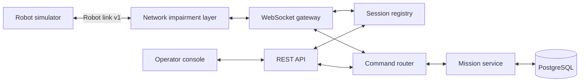

# Week 1 service design

The simulator produces synthetic telemetry and motion. The gateway authenticates and validates frames. The registry owns active session state and the latest sample. The REST API exposes read models and validates command requests. The impairment layer, command delivery, mission service, and console are later work. PostgreSQL currently backs the readiness check.

## Failure modes

| Failure | Detection | Intended robot behavior | What the operator sees | Status |
| --- | --- | --- | --- | --- |
| Robot disconnects mid-command | Transport closure, with heartbeat expiry for silent links | Stop motion on local deadman. Reconnect with known command outcomes. | Disconnected, last sample time, and unknown outcome pending reconciliation. | Transport closure implemented. |
| Operator disconnects holding control | Operator connection closure or lease expiry | Stop accepting motion from the expired authority. Apply local deadman when required. | Expired lease and control ownership state after reconnect. | Design. |
| Duplicate command | Repeated command ID | Return known ACK or result without executing again. | One command record with delivery attempts. | Design. |
| Out-of-order telemetry | Unexpected per-session sequence number | Correct or reestablish the stream using a fresh session. | Last accepted sample stays visible with its age. | Gateway rejects gaps and duplicates. |
| Robot clock skew | Compare robot UTC to gateway time with an RTT estimate | Use a local monotonic timer for safety; withhold time-sensitive actions when clock confidence is insufficient. | Clock warning and gateway receive time for telemetry. | Wire UTC validation implemented. |
| Database unavailable | `/readyz` fails its PostgreSQL query | Continue local simulation and heartbeat where the link is available. | Database-dependent functions unavailable; existing link state remains observable. | Readiness returns 503; link state lives in memory. |
| Gateway restart | WebSocket closes or stops responding | Stop on deadman and reconnect. | Active sessions disappear until connections return. Unknown command outcomes require reconciliation. | New sessions implemented; reconciliation planned. |

The phase targets are p95 command round trip below 150 ms on a clean loopback link, disconnect detection within 3 seconds, a simulated stop within 500 ms of local deadman expiry, and zero expired command executions. Measure these with the impairment and command lifecycle work. See [the v1 contract](W02_Protocol_Spec.md) for the current API and message inventory.
